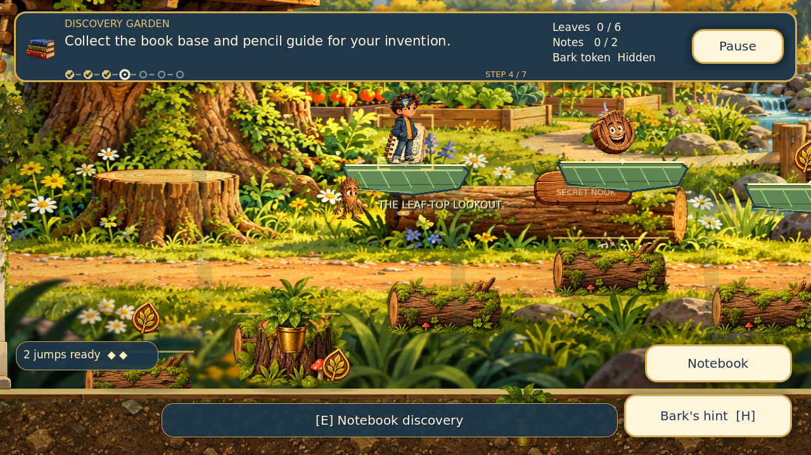
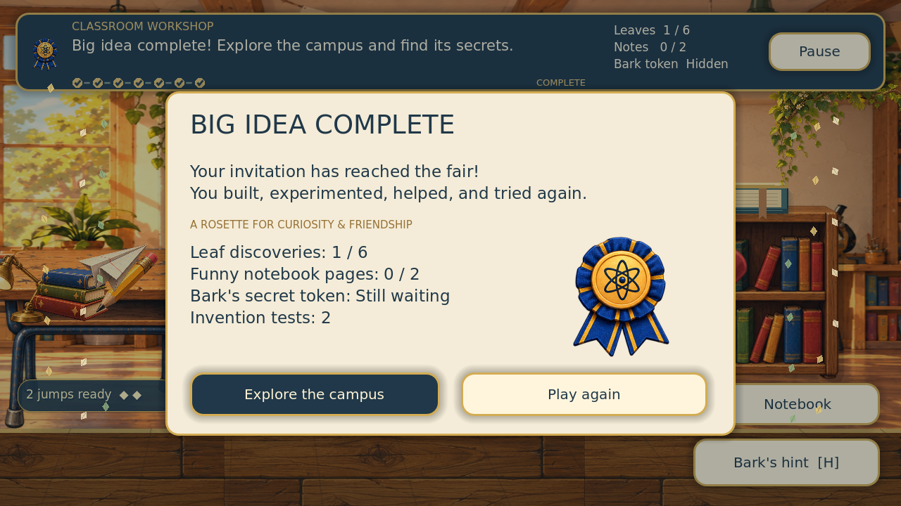
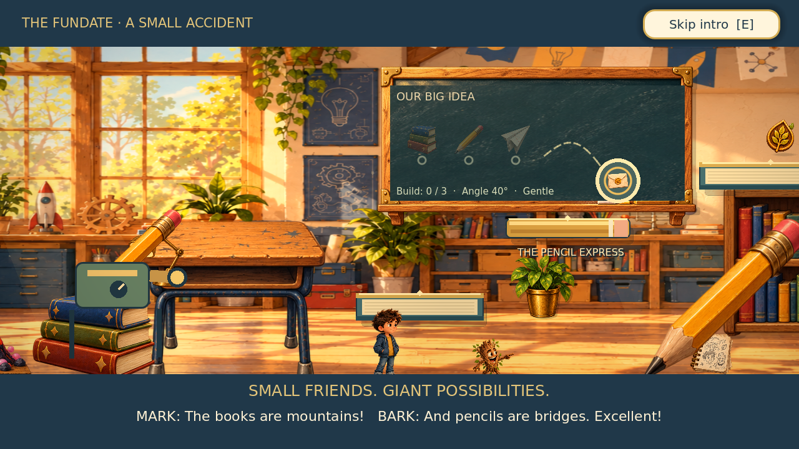
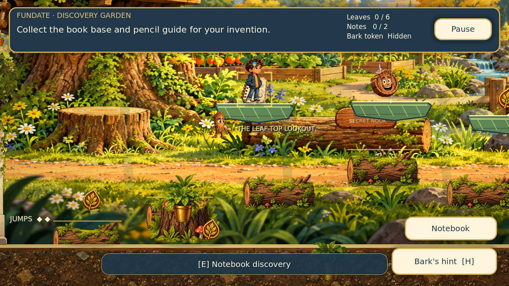
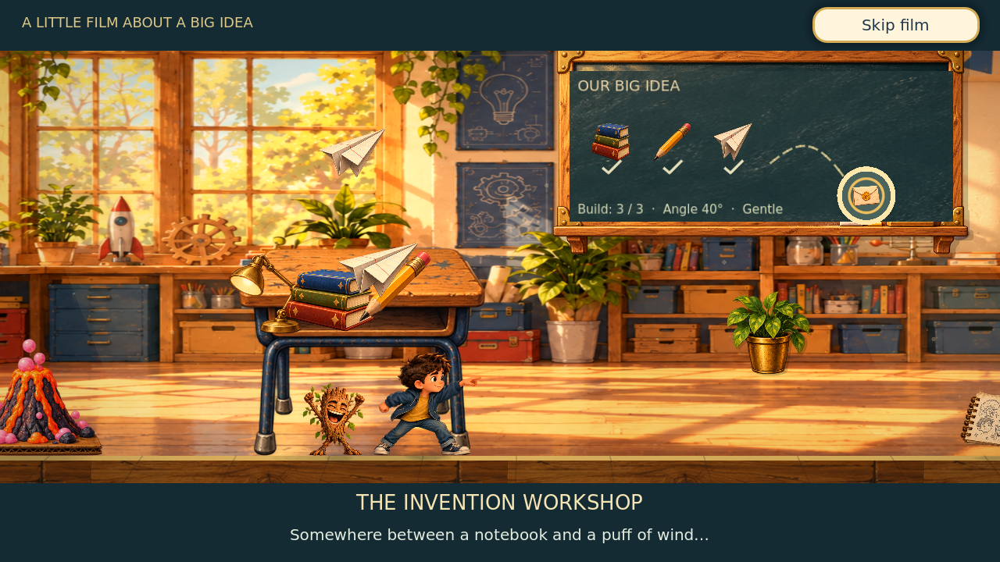
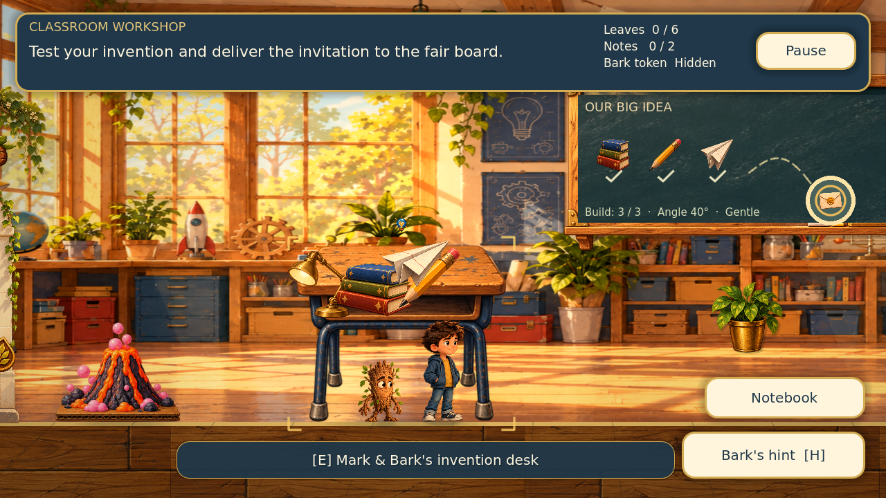

# Mark & Bark: The Big Idea — Ultimate Polish

The **Ultimate Polish** edition refines the Fundate with clearer interfaces, smoother key-pose animation, richer landing and pickup feedback, original music, and a more finished presentation: a garden tutorial, one connected school campus, a seven-step story quest, optional discoveries, and a retryable paper-plane invention workshop.

## Open and play

1. Use Windows **Extract All** (or your normal archive utility) to extract the project ZIP into a fresh writable folder. Avoid extracting over an older running project.
2. Open Godot **4.4.1 or a newer compatible Godot 4 release** (the standard editor; no .NET requirement).
3. In the Project Manager, choose **Import**, select `project.godot`, and open it.
4. Wait for the supplied textures and font to import, then press **F6** with `scenes/main.tscn` open or **F5** to run the project.

No paid plugins, external services, build tools, or asset downloads are needed. The used artwork is bundled in `assets/`. The project ZIP contains editable source, not a standalone operating-system executable. Godot is required to play it this way.

## Ultimate Polish

- **Presentation:** a newly staged title with both friends, balanced world glow and vignette, detailed book bindings, pencil grain and leaf veins, and an ending framed by gentle paper-leaf confetti.
- **Movement:** foot-aligned 65 ms pose crossfades, supplied run poses at full speed, small jump stretch, stable landing edges and a readable two-jump meter. Reduced motion keeps one fully opaque pose and disables extra movement effects.
- **Clarity:** an objective pictogram, numbered quest/lesson progress, completed-step check marks, readable toast cards and dialogue page counts. Touch and keyboard prompts follow the last input used.
- **Interaction:** transient pickup rewards, stable object brackets, assembly component cards, and a short golden plane trail. World props, pickups, collision tops and the live board stay anchored.
- **Menus:** gameplay buttons no longer take keyboard jump focus; menus retain keyboard focus navigation. A dim backdrop isolates dialogue and workshop panels. Pause freezes Mark even in midair, then resumes the same jump. Settings have high-contrast navy text, clear On/Off labels and custom cream/navy toggle icons.
- **Sound:** original seamless plucked music and gentle wind/bird ambience. Master volume controls all audio; music has its own saved toggle. Gameplay modals pause the loops, garden ambience fades between rooms, and audio drains cleanly when the window closes.

The complete shrinking-ray introduction, double jump, three optional high routes, seven-step invention story, room transitions and version-1 save compatibility remain intact. No external downloads or paid plugins are required.

See [Ultimate Polish notes](docs/ULTIMATE_POLISH.md) and `docs/polish_verification.json` for checks and limits. Audio is bundled; `docs/generate_soundscape.py` is an optional reproduction script, not a play-time dependency.




## The Fundate

Bark's ray shrinks both friends in a **15-second, skippable opening**. Ordinary books become mountains and pencils become bridges. Their familiar Big Ideas Fair quest continues at miniature scale.

Press **Space/W/Up again in midair**, or tap **Jump** again, for Bark's leafy lift. Mark gets one air jump, with no precise timing required; landing restores both jumps. Walking off a ledge still leaves an air rescue. Coyote time and landing input buffering are retained. A jump meter, soft wind ring, higher second-jump sound and Bark's cheer make the lift clear. The tutorial teaches it separately from the first jump; skipping unlocks it immediately.

Climb the optional **Book-Spine Skyway** in the hallway, **Leaf-Top Lookout** in the garden, and **Pencil Express** in the workshop. Three leaf tokens, the garden notebook and Bark token reward the higher routes. Ground paths and required supplies stay accessible. The camera rises for high jumps, while room exits still preserve progress and play their named transitions.

The title's **Start adventure**, **New adventure**, and ending's **Play again** use the ray introduction. **Watch the campus film** remains a separate optional tour. Reduced motion replaces the shrink animation with a static size reveal and disables wind rings; every essential action still works. Existing save paths and version-1 saves are preserved.

See [Fundate notes and verification](docs/FUNDATE.md).




## Grounded interactions update

Furniture, room paintings, canopies and pickups now stay anchored in world space; walking and camera tracking no longer slide props against their background. The edited workshop backdrop contains no large painted board. One mounted **live invention board** displays the three assembly steps, launch angle and power, and the fair's delivery target. It marks a successful delivery without changing the launcher solution.

Small stable brackets and a bulb identify the nearby usable object. Interacting gives a gentle world-space pulse. Soft independent shadows ground props and Bark; Mark's shadow sits on the platform beneath him rather than always on the lower floor. Existing rooms, saves and the Godot loading fix are preserved.

This update was runtime-tested in Godot **4.4.1**, with the previous release's Godot 4.7 loading fix retained. See [grounded interaction notes](docs/GROUNDED_INTERACTIONS.md) for checks and art provenance.

## Cinematic edition

A 28-second skippable campus film is available as an optional tour. Choose **Watch the campus film** on the title screen to replay it. E, Enter, Escape, or the large touch button skips it. Watching the film never changes quest progress.

New high-resolution transparent art adds an oak invention blackboard, a reading-nook cabinet and leafy canopy framing. Rear lockers, furniture, plants and near leaves occupy separate anchored render layers with cast shadows. Warm dust-lit shafts, a restrained world-only highlight glow and colour finish, gentle character breathing, and soft landing squash/dust enrich the stages. UI stays crisp above the world shader. Reduced motion fixes the film camera and disables scenery drift, animated dust and landing effects. This remains a 2D game with layered depth and the original character identities and pivots.



See [cinematic edition notes](docs/CINEMATIC_EDITION.md). New art and the recorded generation prompts are included in this editable project.

## Visual overhaul and room travel

The school hallway, discovery garden and classroom workshop now behave as separate rooms. Follow the signed entrances at the left or right screen edge. The camera stops at each room boundary; stepping through an exit plays a short named transition, then places Mark and Bark safely inside the next room. Return trips preserve the quest, supplies and discoveries. The unlocked garden shortcut uses the same transition system. Existing save files remain compatible.

The workshop has a new detailed storybook backdrop and the entrances use a new transparent oak doorway sprite. The original Mark and Bark identities are preserved. Anchored background planes, foreground foliage, warm light pools, sun shafts, contact shadows and perspective floor details add depth while retaining 2D gameplay. Mark and Bark use fuller supplied walk-pose sequences, subtle foot-anchored breathing, and more deliberate hint/cheer poses. Reduced motion disables parallax, ambient specks, butterflies, breathing and character lean, and shortens room transitions.



See [visual overhaul notes](docs/VISUAL_OVERHAUL.md) for implementation details, new-art provenance and generation prompts.

## Controls

| Action | Keyboard | Touch |
|---|---|---|
| Move | A/D or left/right arrows | Hold left/right controls |
| Jump / leafy double jump | Space, W, or up arrow; press again in midair | Tap Jump, then tap it again in midair |
| Interact / next dialogue line | E or Enter | Use / Next |
| Bark's hint | H | Hint button |
| Pause | Escape | Pause button |

Enable **Always show touch controls** in Settings for touchscreen testing. Movement and jumping support separate fingers. Dragging out of a movement control releases it. Native screen-touch events are handled explicitly rather than relying only on first-finger mouse emulation.

Settings include master sound volume, an independent background-music toggle, and reduced motion. Every sound has a visible counterpart. Story dialogue can be skipped, the tutorial can be skipped or replayed, and mistakes do not remove inventory or discoveries.

## Adventure

Learn movement, jumping, a midair double jump, notebook interaction, leaf collection, hints, and plane launching in the quiet garden. Then explore a connected hallway, discovery garden, and classroom workshop.

Recover Mark's notebook, return Bark's misplaced plant, gather the books and pencil, assemble the machine, and deliver the invitation to the fair board. The garden includes an elevated route, six optional leaves, two comic notebook entries, a hidden Bark token, and a shortcut unlocked by helping the garden.

The launcher has three angles and three power choices. Missed planes return automatically. A hint reveals a reliable combination and its trajectory. The ending celebrates discoveries and leaves the campus open for exploration.

The main route is a compact introductory slice. The requested 15–20 minute experience is a design target for relaxed exploration; it is not a measured child playtest result. Experienced players can finish substantially faster. Dialogue and exploration can be expanded through the editable scripts.

## Saves

Quest progress, discoveries, completed tutorial, settings and safe ground checkpoints are stored in `user://big_idea_save.json`. Save writes use a temporary file followed by replacement. New Adventure and Play Again explicitly reset the quest; tutorial replay preserves the existing main quest. Restart Checkpoint preserves inventory and discoveries.

## Project structure

- `scenes/main.tscn`: main scene.
- `scripts/main.gd`: story, tutorial gates, quest interactions, UI, touch input and launcher.
- `scripts/player.gd`: CharacterBody2D movement, coyote time, jump buffering and aligned key poses.
- `scripts/campus.gd`: room layout, props, platforms, pickups and collision geometry.
- `scripts/scenery_planes.gd`: separate furniture and foliage depth planes.
- `scripts/campus_film.gd`: four-shot skippable opening and safe tutorial handoff.
- `shaders/storybook_finish.gdshader`: Compatibility world colour and highlight finish.
- `scripts/depth_layer.gd`: perspective accents, sunbeams, foliage, butterflies and discovery effects.
- `scripts/progress.gd`: persistent state and save validation.
- `scripts/art.gd`: manifest-backed texture access and missing-image fallback.
- `assets/index.json`: the subset of the supplied pack used by this introduction, including pivots.
- `tests/playthrough.tscn`: deterministic runtime regression scene.
- `docs/`: validation report, asset provenance and implementation notes.
- `export_presets.cfg`: optional Web export preset. Export templates are required only if you choose to export.

## Verification

The Godot 4.7.2 startup fix renames the custom ellipse painter in `scripts/depth_layer.gd` to avoid shadowing the engine's built-in `draw_ellipse()` method. The [automated verification workflow](.github/workflows/verify-godot.yml) checks this issue and packages the **complete Godot project ZIP** (including assets), downloadable from the successful workflow run's Artifacts section. This is a Godot source project, not a Windows executable.

This Ultimate Polish release was verified with Godot **4.4.1** on Linux, headlessly and with native OpenGL Compatibility rendering. The previous Godot 4.7 loading fix is retained; this release has not been separately tested in Godot 4.7. Run the regression suite using:

```sh
godot --headless --fixed-fps 60 --path . res://tests/playthrough.tscn
```

The updated suite contains 141 runtime checks, including room crossings in both directions, room camera isolation, shortcuts, transparent doorway art and simultaneous two-finger movement/jumping. It exercises a complete tutorial and campus playthrough with keyboard input and actual CharacterBody2D physics, GUI touch events, assembly, a missed launch and successful retry, ending, optional discoveries, checkpoints, save/load, reduced motion and missing-art fallback. Results are written to `test_output/playthrough.json`; the test restores any pre-existing save after completion.

This is single-player. There is no combat, timer, punishment meter, online service, 3D content, or complete multi-age game. The character art is supplied animation key poses, so pose transitions use timed key poses, short crossfades and stable foot pivots. Future production animation can replace those frames without changing the quest systems. Actual tablets and phones have not been physically device-tested. The updated chapter has been reviewed using native OpenGL screenshots of the title, tutorial, hallway, garden, workshop, room transition and touch HUD. Automated touch events were verified; actual tablets and phones remain untested.

To recreate the visual fixtures on a machine with a display:

```sh
godot --path . res://tests/visual_review.tscn
```

The fixture scene creates screenshots under `test_output/` and never writes a player save.

## Art and sound

Mark and Bark artwork comes from the supplied detailed asset pack. Original pack metadata and art notes are retained in `docs/source_asset_manifest.json` and `docs/ART_ASSETS.md`. Character foot anchors use (256, 612) on the supplied 512×640 canvases. Surface tiles use mirrored repeat; all walkways and collision shapes are separate from the flattened backdrops.

Short audio cues and the new looped music/garden soundscape are original synthesized recordings. The bundled WAV files need no external service; `docs/generate_soundscape.py` documents the optional regeneration process. `assets/readable.ttf` is DejaVu Sans; its license notice is included. No rights to third-party logos, franchises, or unrelated assets are implied. The repository contains the supplied creative material and the implementation; no new license is imposed on the owner's game or artwork.
