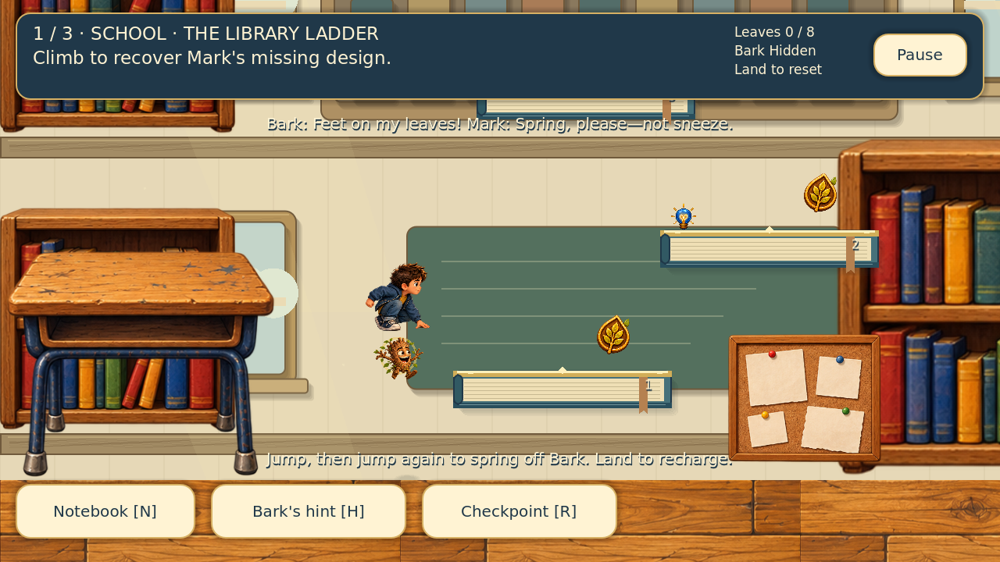

# Mark & Bark — The Tiny, Tall Adventure

The **Mega Vertical Adventure** update turns platforming into the main game. Bark accidentally presses the shrinking ray. Mark and Bark must climb three giant school and home environments, recover a design, power cell and lens, and repair the ray together.

## Play in Godot

1. Extract the ZIP into a fresh writable folder.
2. Open the standard **Godot 4.4.1** editor (or a compatible newer Godot 4 version).
3. Choose **Import** in the Project Manager and select `project.godot`.
4. Let the bundled textures and font import, then press **F5**.

This is a ready-to-import, editable Godot project. Godot is required; the ZIP is not a standalone Windows/macOS executable. No paid plugins, .NET, build tools or additional asset downloads are needed.

## The three climbs

| Level | Theme and objective | Climbing difficulty |
|---|---|---|
| The Library Ladder | School library/classroom; recover Mark's missing design | Gentle: broad 280 px books; 140–210 px rises |
| The Bedroom Beanstalk | Mark's home bedroom, bed, wardrobe and writing desk; retrieve the pocket-sized power cell | Adventurous: 244 px books and pencils; rises up to 220 px |
| The Invention Attic | Home attic, timber beams, crates and invention supplies; collect the ray's golden lens | Daring: 208 px landings; rises up to 230 px |

Every level has **eight optional leaf tokens**, a hidden Bark token on a side shelf, numbered platforms, checkpoints and a delivery point at the summit. The quest item sits on the shelf just below the summit. Land beside it, use it, then climb to the delivery point and use that to complete the level. Completing a climb unlocks the next. The last delivery repairs the ray and plays the restored-size ending.

The story never requires optional collectibles. There are no enemies, damage penalties, countdowns or lost items. Explore after completion or replay from Level Select; replay resets that level's run while preserving its best score.



## Controls and the Bark spring

| Action | Keyboard | Touch |
|---|---|---|
| Move | A / D or Left / Right | Hold an arrow |
| Jump | Space, W or Up | Tap Jump |
| Spring off Bark | Jump again near the first jump's apex | Tap Jump again |
| Pick up / deliver | E or Enter | Use |
| Ask for help | H | Bark's hint |
| Notebook / progress | N | Notes |
| Return to checkpoint | R | Checkpoint |
| Pause | Escape | Pause |

**Jump once, then again as Mark rises near the top of his first jump.** Bark appears under his feet, braces his leafy head and springs Mark upward. Mark crouches on contact and releases into the supplied jump pose. Landing recharges both jumps. Walking off a ledge still leaves a rescue spring. You cannot perform a third airborne jump.

Checkpoint bulbs mark every second main shelf. Landing there saves the highest checkpoint. **R / Checkpoint** returns you there with every item intact. Bark's hint explains the current objective and briefly marks the next shelf. Pause freezes movement, and losing window focus pauses the climb and releases held movement.

Touch controls switch on after a touch event, on mobile platforms, or through **Always show touch controls** in Settings. They support holding movement with one finger while jumping with another. Use landscape orientation. Mouse-clicking the visible Jump/Use buttons also works.

Settings include master sound volume, a separate music toggle, reduced motion and touch visibility. Reduced motion removes dust, pickup bobbing, camera smoothing and extra spring stretch while keeping a clear contact pose. Dialogue and ray cinematics can be skipped.

## Saves and the original chapter

The campaign saves locally in Godot's user-data folder as `mark_bark_mega.json`. It stores the current level, unlocked levels, highest checkpoints, quest items, collected tokens, tutorial/story acknowledgement and best scores. Settings use the existing original save. **New adventure** asks before resetting this campaign.

The original school adventure, tutorial and paper-plane workshop remain bundled. Open `scenes/main.tscn` and press **F6** to play that chapter. Its previous progress file is preserved. F5 launches the new three-level campaign.

After the full-sized ending, **Explore this level** returns to the miniature attic climb so shelves and remaining collectibles stay playable. The ending does not permanently change gameplay scale.

## Editing and verification

- `scenes/mega.tscn`: new campaign entry point.
- `scripts/mega_main.gd`: story, HUD, input, menus, hints and teamwork animation.
- `scripts/mega_level.gd`: the three authored routes, collisions and pickups.
- `scripts/mega_scenery.gd`: anchored school/home architecture, layered furniture and lighting.
- `scripts/mega_ray.gd`: shrinking and restored-size cinematics.
- `scripts/mega_state.gd`: separate campaign save and best scores.
- `scripts/player.gd`: shared responsive movement, coyote time, jump buffering and supplied character poses.

Artwork keeps Young Mark, Bark, the storybook palette and the supplied individual sprites. Characters keep the supplied **(256, 612)** foot anchor on **512 × 640** canvases. Collision geometry is independent of painted scenery; collectible positions and furniture stay in world space. The library has one classroom blackboard. Upper tiers use library alcoves. Home furniture and the ray are drawn with matching oak, navy, cream and moss materials.

Run the campaign's full physical playthrough:

```sh
godot --headless --path . --fixed-fps 60 res://tests/mega_playthrough.tscn
```

For native rendered screenshots, omit `--headless` and append `-- --screenshots`. The test climbs every required shelf and secret branch with actual double-jump physics, exercises keyboard and multi-finger touch input, obtains and delivers each quest item, checks checkpoint recovery, saves/reloads progress and completes the final cinematic. Outputs go to the ignored `test_output/` folder.

The original chapter's regression suite remains at `tests/playthrough.tscn`. See `docs/MEGA_VERTICAL_ADVENTURE.md` for implementation and validation details. Cross-device testing on physical Android/iOS hardware and standalone platform exports are outside this source-project delivery.
