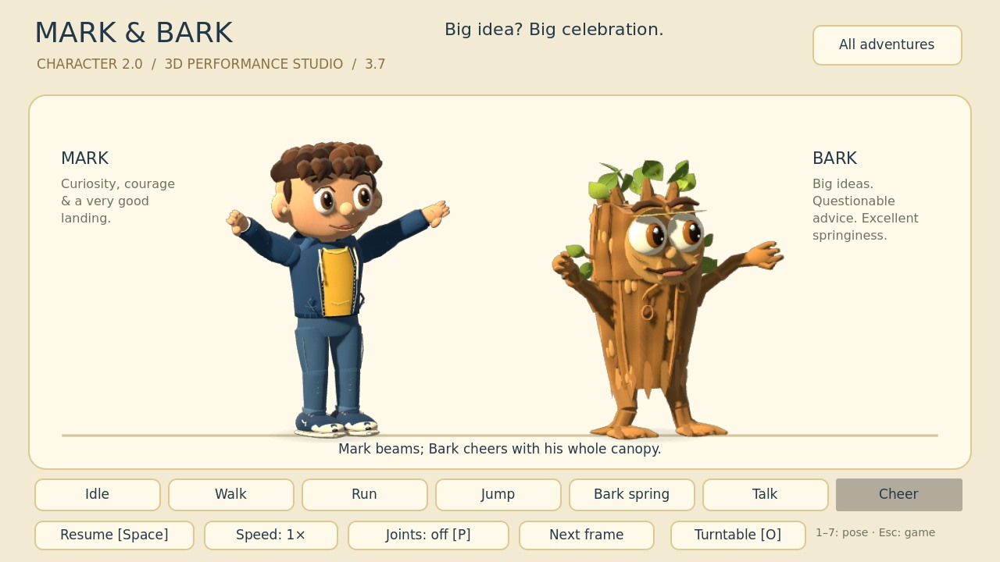
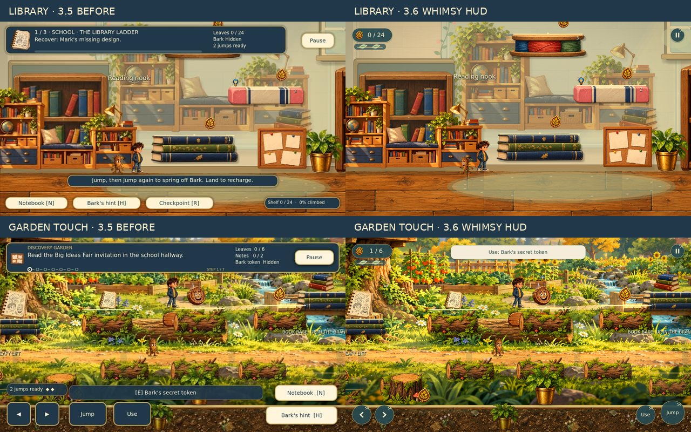
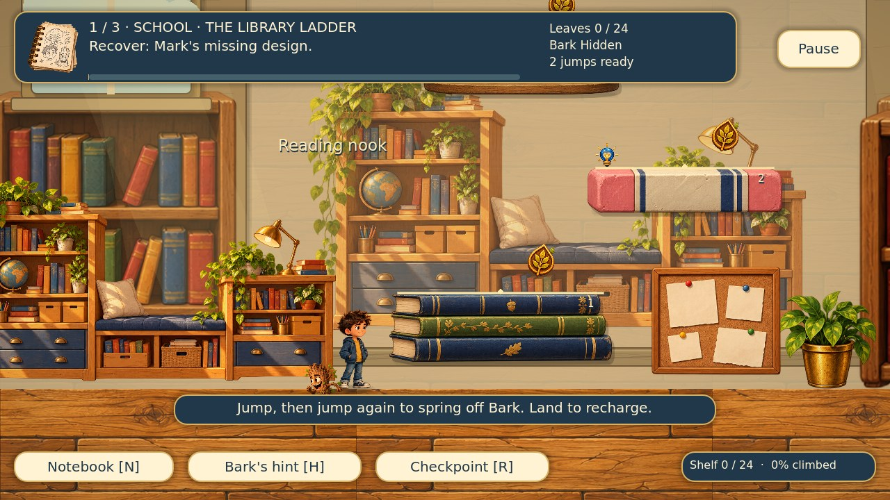
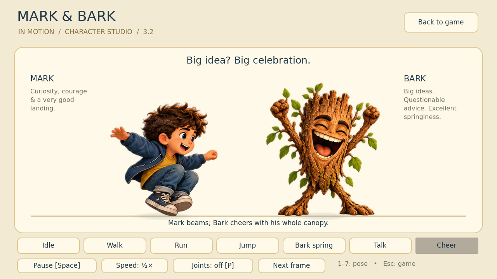
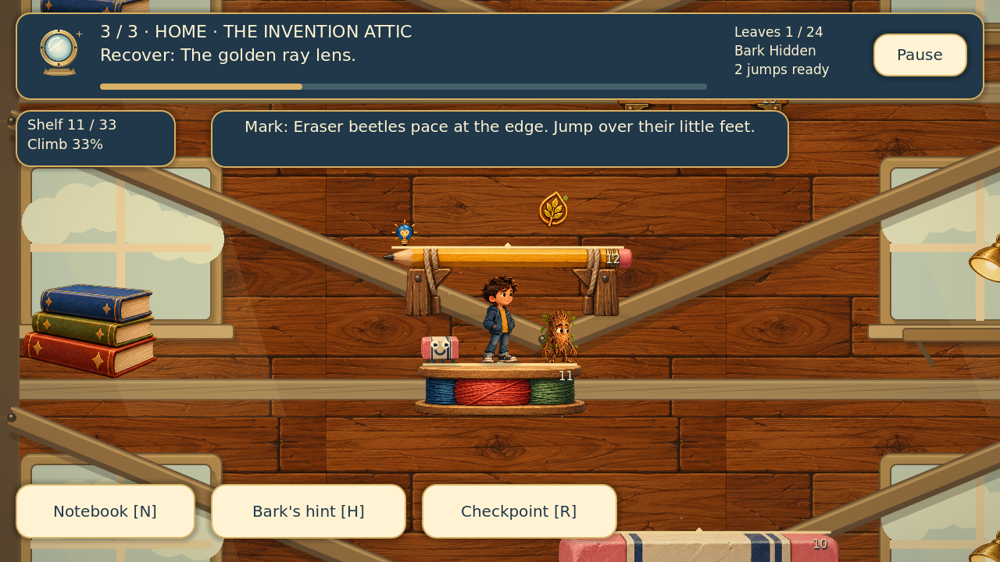

# Mark & Bark 3.7.0 — Character 2.0

A finished, child-friendly 2D platform adventure for Godot. A shrinking-ray mishap turns school and home into three towering playgrounds. Mark and his mischievous tree friend Bark must recover a design, a power cell and a lens, then repair the ray together.

**Both adventures are accessible again.** The illustrated opening menu offers the full original campus story, all three giant climbs, the campus film and the character studio. The school hallway, discovery garden, workshop puzzle, tutorial and discoveries were still bundled in 3.2, but its normal menu could not reach them.

**3D storybook** is now the default character style. Mark and Bark have real modeled bodies, articulated limbs, expressive faces and directional lighting. They turn in depth inside the existing painted world. **Settings → Character style** also offers **Original painting** and **Articulated painting**, retaining the supplied PNGs and the earlier 2D skeleton renderer. The opening menu has a quick **Character 2.0 / 3D** switch.

The original chapter's book/pencil platforms use the painted atlas, and its leafy routes use the supplied mossy branch artwork. Physics and landing positions are unchanged. The climbing campaign remains a distinct mode. See the [original restoration audit](docs/RESTORATION_AUDIT_3_2_1.md).

The **3.2.2 finishing pass** makes the opening music loop reliably, shares one settings panel across both adventures and the opening menu, protects both save files with validated backups, and adds production Web and Windows export checks. See [the finishing notes](docs/FINISHING_3_2_2.md).

## Character 2.0 — the 3.7 update



Mark keeps his chestnut hair, navy hoodie, golden T-shirt and sneakers, now shaped in three dimensions with layered clothing, separate fingers and detailed shoes. Bark gains a broad carved trunk, uneven crown, wood grain, branch hands, root feet and folded leaves. Both friends have a little more presence while keeping their feet anchored to the established world positions.

The animation system drives actual 3D joints: planted-foot walk and run poses, jump reach and tuck, Bark's spring contact and release, landing recovery, conversation and celebration. Blinks, gaze, eyebrows and mouth movement bring the faces to life; clothing and leaves follow the main motion. Mark holds a modeled notebook during his notebook pose. Turning changes the model's angle instead of flipping a flat image.

The character studio adds a **Turntable [O]** control alongside joint points, pause, half speed and frame advance. Dialogue portraits use the new models too. Pause freezes the performance, and Reduced motion removes idle flourishes while retaining readable gameplay poses. The 3.6 minimal HUD, painted levels, collisions, jump timing, quests and saves remain intact. See the [Character 2.0 implementation and editing notes](docs/CHARACTER_2_0_3_7.md).

## The Whimsy HUD redesign

The game now has just three small essentials: a leaf-score capsule, two spring-energy leaves and a round Pause button. The big quest header, shelf panel, jump text and shortcut rows have moved into the Notebook and Pause menu. Touch mode keeps compact movement/Jump controls; Use appears near relevant interactions. Brief paper cues replace the constant task banners.



The idle keyboard overlay is **91.8% smaller**, and idle touch overlay is **85.1% smaller**, against the former Library panel layout. Score gains get a tiny animated `+N` leaf flourish; Reduced motion makes updates immediate. The two leaves reflect the actual jump charges, with landing recharge. Objectives, hints, checkpoints and all keyboard shortcuts remain available. See [the HUD design and verification notes](docs/WHIMSY_HUD_3_6.md).

## The 3.5 Whimsy Update

The library grows flowering arch garlands, pressed-botanical illustrations and folded paper birds. The bedroom gains cloud murals, moon-and-star mobiles and embroidered bedding. The attic opens onto crescent skies, constellation charts and miniature ringed planets. Woven rugs and soft pastel washes bring the rooms together with the original painted furniture.

The original school, garden and workshop also gain paper-and-botanical ornaments, wisteria, flower borders and a brass celestial mobile. A sparse layer of paper moths, petals and tiny lights gives both adventures gentle movement. Decorations stay in world coordinates and keep routes and prompts clear; Reduced motion keeps a still version of the ornaments, and opening pause or Settings freezes their animation.

The 3.4 contact shadows, bloom and lighting remain. Character artwork, routes, collision, collectibles, quests, controls and save formats are preserved. See [the Whimsy release notes](docs/WHIMSY_UPDATE_3_5.md).

## Graphics, shadows and depth across both adventures

The library, bedroom and attic now have distinct composed scenery, softer directional shadows and separate lighting moods. The original school, garden and workshop gain richer ambient light, clearer floor contact and restrained distant depth. Original character paintings and every route are retained.

Both friends use one consistent contact-shadow system in each game: shadows stay on supporting surfaces and become softer and lighter in the air. Painted platforms cast matching soft shadows. Background objects stay anchored; parallax is limited to distant garden silhouettes and is disabled with Reduced motion.

Ambient scenery pauses with the adventure. Grading and bloom are applied below the HUD so text, menus and controls remain sharp. See [the graphics release notes](docs/PAINTED_DEPTH_3_4.md).

## The 3.3 Library Ladder visual upgrade



The first climb now uses the existing painted bookcases, reading nooks, plants and props in varied library alcoves, with warm window light and independent contact shadows under both friends. Painted platforms gain soft cast shadows. A compact keyboard HUD opens more of the scene; touch controls keep their familiar hit areas. Small spring, landing and checkpoint rings respect pause and Reduced motion. The 3.3 pass focused on the library; 3.4 extends the graphics treatment across both adventures.

All original artwork, routes, collision shapes, jump physics, collectibles and story remain intact. See [the Library Ladder notes](docs/LIBRARY_LADDER_3_3.md).

## Play

1. Extract the ZIP into a fresh, writable folder.
2. Open **Godot 4.4.1**, choose **Import**, and select `project.godot`.
3. Let the bundled art and font import. Press **F5**.

Choose **The Big Idea** for the complete painted school/garden/workshop story, or **The Giant Climbs** for the three extended vertical levels. Both keep their existing progress. **All adventures** in either title, or in the studio, returns to the opening selection.

Everything needed to play is bundled. No paid plugins, .NET, Python or extra asset downloads are required for the game. The GitHub verification workflow also produces a **Windows ZIP** (extract it and run `Mark-and-Bark.exe` beside its `.pck`) and a **Web ZIP** (serve the complete folder over HTTP; opening `index.html` directly is unsupported). Python is only needed for the optional developer verification tools.

## Meet the livelier Mark & Bark

The current **3D storybook** style uses native Godot meshes and a separate lit 3D scene for each character. A transparent viewport places that performance in the painted 2D scene. The levels and physics remain 2D; the characters themselves have real depth. The original and articulated painting styles remain available in Settings.

The earlier **3.2 articulated painting** style uses native Godot 2D skeletons over the original painted exports. Its original showcase remains available:



The jump impulse, controls, collision bodies, routes and forgiving input timing are preserved. The animation never waits for a button press to finish playing before Mark moves. Small spring leaves stay at the launch point. Pause freezes the performance, checkpoints clear it, and Reduced motion removes the extra deformation and effects.

Choose **Character studio** on the opening menu, or open `scenes/animation_studio.tscn` and press **F6**. Select Idle, Walk, Run, Jump, Bark spring, Talk or Cheer; pause, advance one frame, choose half speed, show the joint points or turn the 3D models. **1–7** selects a pose, **Space** pauses, **P** toggles points, **O** toggles the turntable and **Esc** returns to all adventures. In the climbing campaign, **F8** toggles the two actors’ joint overlays.

See the [recorded character and gameplay showcase](docs/previews/in_motion_3_2.mp4) and [rigging/editing notes](docs/IN_MOTION_3_2.md). The studio is a separate preview room; its jump display is a pose study. The live gameplay segment in the recording uses the actual campaign player and double-jump physics.

## Three much bigger adventures

| Climb | Setting | Main platforms | Ascent |
|---|---|---:|---:|
| The Library Ladder | School reading nook, pencil crossing and roof library | 24 | 4,410 px |
| The Bedroom Beanstalk | Toy corner, wardrobe trail and window garden | 27 | 5,400 px |
| The Invention Attic | Workshop floor, thread loft and ray observatory | 33 | 7,080 px |

Each ascent is **three times the height of 2.0.2**. Every level has 24 optional leaves spread through its full height, three reachable side nooks and one hidden Bark token. The quest item is on the platform just below the summit. Land beside it, collect it with **E / Use**, then deliver it at the summit.

The route has six new painted platform materials: books, pencil bridges, rulers, erasers, thread spools and timber ledges. Cream landing seams, numbered shelves and checkpoint bulbs make the way readable. Broad bridges offer breathing room between higher jumps.



## Two jumps, one team

Move with **A/D or arrows**. Press **Space** to jump, then press again near the first apex to spring off Bark. Bark anticipates the first jump, braces beneath Mark and eases back into position after release. Jump input responds immediately. Landing recharges both jumps; walking off a ledge still leaves a rescue spring. There is no third airborne jump.

| Action | Keyboard | Touch |
|---|---|---|
| Move | A/D or Left/Right | Hold an arrow |
| Jump / Bark spring | Space, W or Up | Tap Jump, then Jump again |
| Collect / deliver | E or Enter | Use |
| Hint | H | Bark’s hint |
| Notebook | N | Notes |
| Highest checkpoint | R | Checkpoint |
| Pause | Escape | Pause |

Touch controls appear after a touch event or through **Always show touch controls** in Settings. Hold movement with one finger and jump with another. Use landscape orientation.

## Small pests, forgiving retries

Eraser beetles pace, dust bunnies bob and paper moths flutter. Mark gives a practical dodge tip when approaching. Enemies occupy the far side of a landing, leaving room to arrive safely. Jump or spring past them. Mark has **no attacks, weapons or powers**.

A bump returns Mark to his last safe shelf with every quest item and collectible intact. A recovery window prevents immediate repeated bumps. **R / Checkpoint** returns to the highest saved rest shelf. Both recovery paths place feet above the platform, then settle safely on it.

**Calm climb** lets players pass pests harmlessly. It does not alter jumps, routes or collection rewards. This preference remains available across new adventures. Pause and dialogue freeze patrols and recovery timers.

## The 3.1 quality pass

- Clearer title, illustrated level selection and a redesigned notebook with objective, discoveries, nooks and checkpoint progress.
- Practical return hints for all nine side routes; important tips remain readable when a leaf is collected.
- Smooth Mark-on-Bark contact and release, quick double taps, direction changes, low-ceiling landings and clean checkpoint resets.
- Bark leaves pests visible instead of standing over their silhouettes.
- Correct desk, mug and lamp placement using supplied prop pivots; bracketed wall shelves support the attic lamps.
- Layered timber, window lighting, soft grounding shadows and independently anchored scenery.
- Backdrop coverage includes jumps above the summit. Nearby scenery bays draw at fixed world positions with generous overlap, bounding rendering cost.
- Master volume, music, reduced motion and touch settings. Reduced motion removes extra bobbing, wing flutter, dust and camera easing while preserving readable gameplay.
- Atomic saves, compatibility with earlier campaign saves, validation of malformed values and recovery from the previous valid backup.

## Ending and replay

The final delivery repairs the ray and plays the restored-size story ending. Explore afterwards, revisit unlocked levels, or Replay a climb for a fresh collection run while keeping best scores. Optional discoveries never block the story.

The original school adventure, tutorial and paper-plane workshop are available from **The Big Idea** on the opening menu. Its quest progress remains separate from climbing progress; audio, touch, reduced-motion and character presentation preferences are shared.

## Saves

Both adventures use Godot’s standard user-data folder for **Mark & Bark: The Big Idea**. `big_idea_save.json` stores the original story and shared preferences; `mark_bark_mega.json` stores climbing progress and calm mode. Each now retains a validated `.bak` of the previous valid save. A missing or corrupt primary recovers from its backup. Version 1 climbing saves remain readable; version 2 supports the extended upper checkpoints and all 24 leaves.

Settings on the opening menu and inside either adventure offer the same volume, music, reduced-motion, touch, character-style and calm-climb controls. Changes apply immediately and persist across restarts. Existing saves gain the 3D default when the new preference is absent; the earlier painting preference remains available when choosing a painting style. A failed save shows a visible status; closing the native game after a failure offers **Try again**, **Keep playing** and **Quit anyway**.

The application name stays unchanged so previous save locations remain compatible. New adventure asks before resetting this campaign and its scores; accessibility preferences and original-chapter progress are preserved.

## Verification and editing

The complete, isolated check suite runs with:

```sh
python3 tools/verify.py --godot /path/to/Godot
```

It imports a fresh copy with a unique, verified test-save location, runs all **thirteen suites** and writes logs to the ignored `test_output/` folder. The new character suite checks actual 3D mesh volume, joint motion, facing, pause, Reduced motion, source-art retention, style switching, preference migration and integration across both adventures. Native rendering adds transparent-character framing and scene screenshots. The existing suites retain HUD, scenery, music, settings, save recovery, original-art and complete-playthrough coverage. The campaign test physically climbs every required shelf and all nine side routes, collects all 72 leaves, delivers all three quest items, exercises keyboard and multi-touch input, checks safe checkpoints and completes the ending.

The GitHub workflow runs the complete suite on Godot **4.4.1**, captures native screenshots, builds the production Web and Windows releases with official checksum-verified templates, and tests the packed game in fresh processes. It plays the actual Web release in Chrome, checks settings after a page reload, and runs the exported Windows executable on Windows. Source, builds, screenshots and logs are downloadable workflow artifacts. See [export commands and verification boundaries](docs/FINISHING_3_2_2.md).

Native Godot compatibility-renderer playthrough and visual fixtures were also reviewed. See [3.2 character update and editing notes](docs/IN_MOTION_3_2.md), [3.2 verification results](docs/release_3_2_verification.json), and [the earlier campaign artwork provenance](docs/RELEASE_3_1.md).

Physical Android/iOS device testing, macOS exports and hardware performance measurements are outside this release's verification scope. The tests cover keyboard, mouse and injected multi-touch events in Godot; automated browser rendering uses software graphics.
