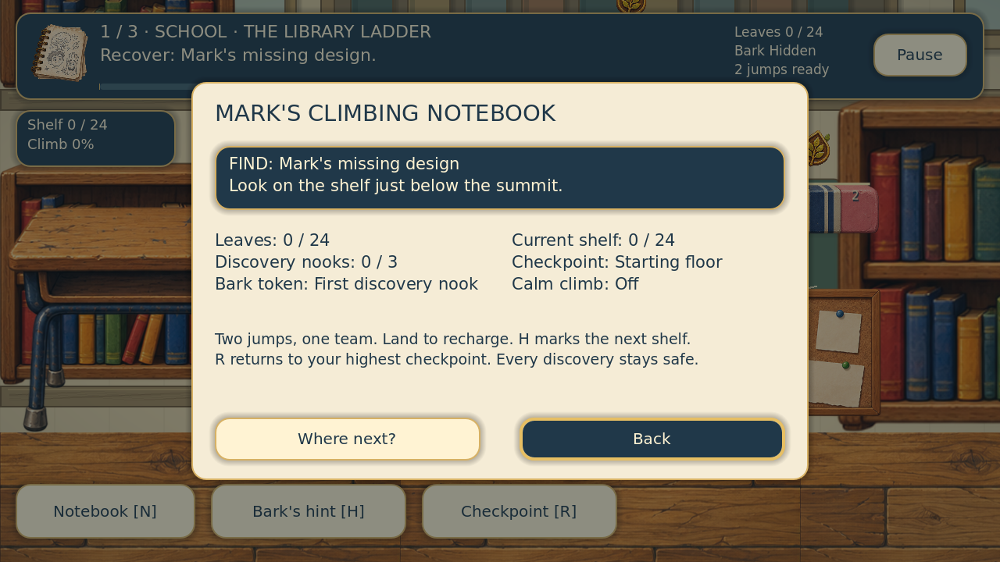

# Mega Variety 3.1 — The Complete Climb

This release restores the unpublished Mega Variety expansion on the confirmed GitHub 2.0.2 source, then reviews the longer game as one complete introductory campaign. No later unpublished working files are assumed to exist.

## Route design

Three school/home climbs contain 24, 27 and 33 required platforms, ascending 4,410, 5,400 and 7,080 pixels respectively. These are exactly three times their earlier heights. Each climb has three named districts, a checkpoint on every second main shelf, three optional nooks and one Bark token. Twenty-four leaf IDs are distributed across the entire route, including the upper attic and summit. Nook leaves use IDs 4, 12 and 20; all discoveries remain optional.

Pencil bridges provide wider rests; rulers, book stacks, erasers, spools and planks change the silhouettes and materials. Side routes sit away from the next main platform so a jump cannot be intercepted by an unintended upper landing. The original jump impulses, gravity, forgiving input timing and double-jump limit remain intact.

## Encounter design

Eraser beetles pace, dust bunnies bob and paper moths flutter. Their small patrol areas sit on the far edge from an arriving player, leaving room to land and plan the next jump. Mark gives a short, practical tip. There are no player attacks, weapons, damage meters or powers.

A bump returns to the last safe landing with discoveries intact. The recovery window lasts approximately 1.8 seconds. R returns to the highest saved checkpoint. Respawns explicitly use the platform top rather than its rectangle centre; both paths settle above the one-way collision surface. Calm climb permits harmless contact without altering progress or jumping. Pause, story panels and level transitions freeze hazards and their recovery timers.

Bark moves to the other side of Mark when his normal following position would cover a nearby pest. Contact anticipation, bracing, release and recovery keep the original supplied foot pivots. Quick repeated taps, direction changes, low ceilings and checkpoint interruption are covered by tests.

## Visual and interface review

The title, level cards, instructions, HUD, notebook and ending all describe the expanded game and its 24-leaf counters. The notebook separates the main objective from discoveries and checkpoint details. Important warnings and dodge tips cannot be overwritten immediately by a leaf notice. Keyboard, mouse and touch share the same actions.

The attic lamp rests on the desk; repeated lamps stand on bracketed wall shelves. The bedroom mug rests on the desk surface. Background props use the supplied pivots. Layered beams, timber grain, window lighting and soft shadows provide depth without moving furniture with the player. A padded backdrop covers jumps above the summit, and camera-adjacent scenery bays keep drawing cost bounded. All bays retain fixed world positions.

The painted atlas lives at `assets/variety/platform_atlas.png`; `regions.json` records each actual sprite rectangle. The generated objects cross their nominal row boundaries, so individual alpha bounds are used instead of equal-cell cuts. Collisions remain separate flat gameplay geometry, with a light top seam to make landing surfaces clear. The eraser beetle reuses the painted eraser texture. Other pest silhouettes and animations use native drawing code. Original character exports, identities and (256, 612) foot anchors are preserved.

Generation used the built-in image tool with genuine transparency. The complete prompt and production paths are in [artwork_3_1.json](artwork_3_1.json).

## Save recovery

Campaign save version 2 accepts version 1 saves, bounds numeric fields, rejects duplicate or invalid leaf IDs and validates boolean fields without unsafe mixed-type comparisons. Atomic writes keep the previous valid primary file as a backup. A malformed primary can load that backup; the title reports actual recovery. New adventures preserve calm mode and original-chapter settings. Replays preserve best scores. Original chapter progress remains in its own file, and the application name is retained for compatibility.

## Verification

`tools/verify.py` imports the project, isolates save data and runs all five suites. It passed 540 checks: 175 original chapter, 21 teamwork jump, 61 interface, 85 variety/recovery and 198 full-campaign checks. These include physically climbing every required platform and all side routes, collecting all 72 leaves, quest delivery and the ending, keyboard and multi-touch input, safe loaded checkpoints, enemy recovery, calm mode, malformed saves and backup recovery.

The full campaign was also run with Godot's native compatibility renderer. Visual fixtures cover title, level selection, instructions, settings, notebook, each floor, higher routes and the camera above the summit. The delivered ZIP is checked for integrity and imported again from a fresh extraction. Results are recorded in `release_3_1_verification.json`.

This delivery is editable Godot source with bundled artwork, audio and tests. Open `project.godot` in Godot 4.4.1 and press F5. Use F6 on `scenes/main.tscn` for the original chapter. Physical mobile-device testing and standalone exports are outside the scope of this source project.
