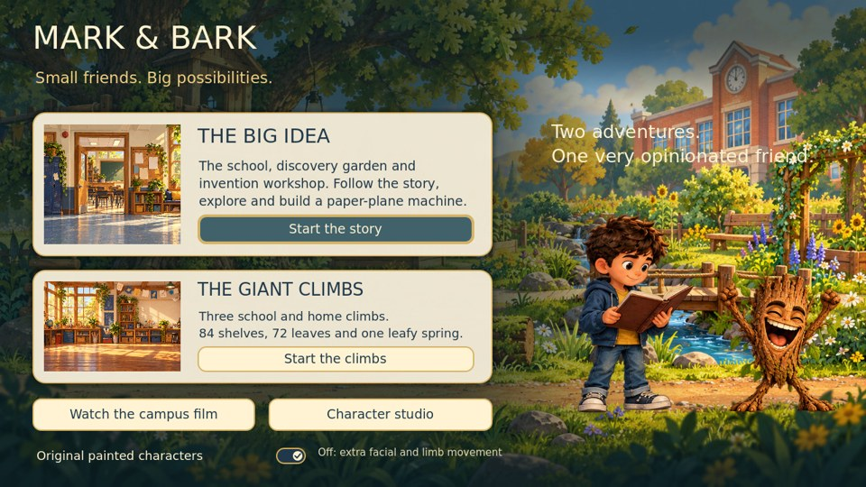
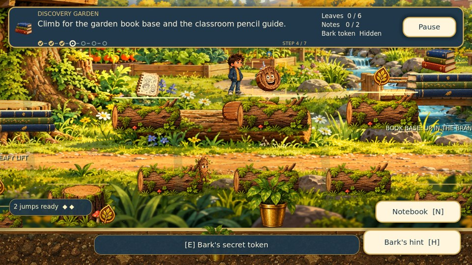
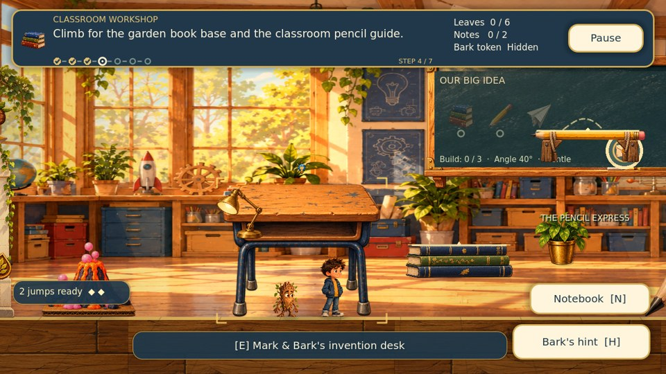

# Mark & Bark 3.2.1 — regression audit and restoration

Reviewed the complete published history through `0f0067035fc12d9047127500ba9a92da22991b8b` (3.2), including the original introductory adventure, cinematic updates, Mega Vertical Adventure, 3.1 expansion and 3.2 character update. Reproduced the game in Godot 4.4.1 with native Compatibility rendering, and compared source paintings with articulated characters.

## Findings

| Symptom | Verified cause | Repair |
| --- | --- | --- |
| The game looks much simpler than the earlier painted campus | Commit `42a07b3` changed F5 from `scenes/main.tscn` to the separate `scenes/mega.tscn`. The latter uses `mega_scenery.gd`: repeated code-drawn windows, wardrobes and wall bays, with some painted props. The original campus uses the full painted school, garden and workshop environments. | F5 now opens an illustrated selection containing both complete adventures. The painted campus story is the first choice. The climbing campaign remains available with its existing routes. |
| The garden, room travel, invention workshop and opening film appear deleted | Those files and mechanics are still present. The 3.2 menu offers no path into the original scene; the README required opening a scene manually and pressing F6. | Both titles and the studio have **All adventures**. The selection opens the full campus story or climbs, and can play the campus film directly. Actual scene transitions and independent progress are tested. |
| Character appearance differs from the supplied painting | Commit `0f00670` changed `Art.character()` globally to a skinned mesh and facial shader. All 40 painted action/turnaround PNGs remain intact. Native idle comparisons did not show wholesale replacement or missing original characters. The extra deformation is a presentation choice, however, and previously had no independent off switch. | **Original painted characters** is on by default. All original walking/running/jump textures remain in use, while the full source painting is drawn without mesh/face deformation. Turning it off restores the 3.2 articulation; the studio always retains articulation. Reduced motion remains a separate setting. |
| Some ledges look like flat stand-ins against the detailed world | The original chapter's `fun_platform.gd` draws books, pencils and leaves from simple shapes. The later campaign bundles a much richer painted platform atlas which the original chapter never adopted. | The original chapter now shares the existing painted book and pencil atlas. Its garden routes use the supplied moss-covered log artwork. Landing edges, platform width, collision bodies and jump distances are unchanged; the existing physical playthrough still exercises the required ledges. |
| Older scenes do not consistently pause or animate the new character rig | The shared player/character factory changed in 3.2, but the original chapter did not receive the new Bark drive/freeze integration. During a modal pause Bark could still ease toward the player while his new skeleton continued moving. | The original chapter explicitly drives and freezes Bark, and holds his position during pause. The new tests check both characters' animation clocks and companion position, then verify resume. |
| A missing pose can silently turn into a gold square | `Art.tex()` returned the same generic generated square for any unresolved artwork. A legacy Mark cheer alias was repaired in 3.2, but other invalid poses still used the generic path. A rig could also retain a previous calibration when receiving uncalibrated artwork. | Missing art is recorded and warns once. Unknown Mark/Bark poses fall back to their own idle painting. Uncalibrated textures clear the previous profile and use the complete sprite. Tests cover both cases and verify that normal play requests no missing art. |
| Passing checks did not catch the loss of the normal game entrance | The 629 checks pass on 3.2, but instantiate their chosen scenes directly. The old GitHub workflow runs only the original chapter's playthrough and downloads 4.7.2 despite the current README specifying 4.4.1. | A new suite tests the configured entry point, real menu actions and scene changes, artwork availability, source-paint presentation, platforms, progress and return navigation. CI now uses the documented 4.4.1 and runs all seven suites, plus native screenshots. |

## What was and was not removed

The published Git history contains no deleted files. None of the original character PNGs, painted backdrops, props, sounds, original story systems or three climbing routes is removed by this repair. The main loss was access and visual consistency, not erased source images.

The older-age Mark chapters mentioned in early concept planning are not implemented in this published playable repository. Its original design notes explicitly limit this slice to Young Mark and Bark; they are not later deletions that can be restored from this history. Similarly, the existing game is a 2D sprite adventure with optional 2D skeletons, not a 3D-character game.

This repair does not redesign every climbing-room background or pest. Its deliberately simpler repeated climb scenery remains visible in that mode. It restores the full painted story, makes the presentation choice explicit, and connects existing painted platform artwork instead of claiming that every part of the game has received a new art pack.

## Review the result

The images are captures from the running Godot project. The game assets themselves are unchanged PNGs, not reconstructions of the screenshots.

## Validation

The original 629-check suite passed before repairs. After repairs, all seven suites contain 697 checks: 175 original chapter, 21 teamwork jump, 61 interface, 85 variety/recovery, 198 complete campaign, 89 animation and 68 restoration checks. The complete campaign suite physically traverses all main platforms and side routes, collects all 72 leaves and completes all quest deliveries and the ending. The original chapter suite physically reaches its high shelves and completes the invention puzzle.

The 68 restoration checks also pass through the native Compatibility renderer. Native screenshots cover the real opening selection, garden, workshop and return from the studio. `release_3_2_1_verification.json` records the engine, measured results, asset integrity and rendering environment.

No physical phone/tablet hardware validation or standalone executable export is claimed. Existing save locations and application name are retained. No original story or climbing progress is reset when switching modes.
