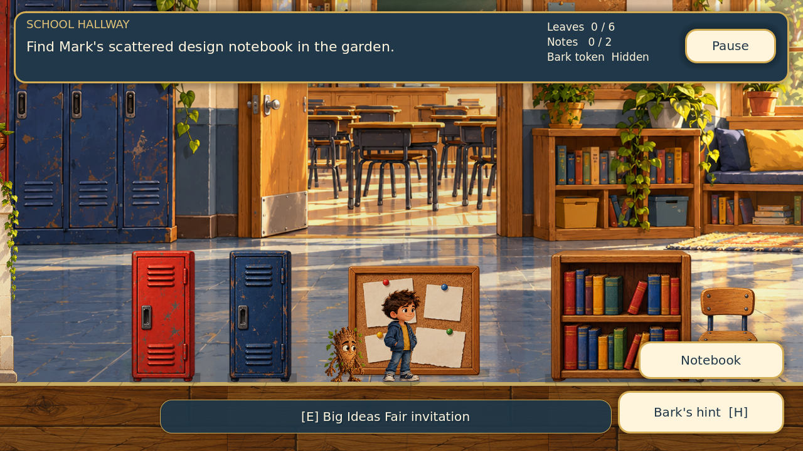
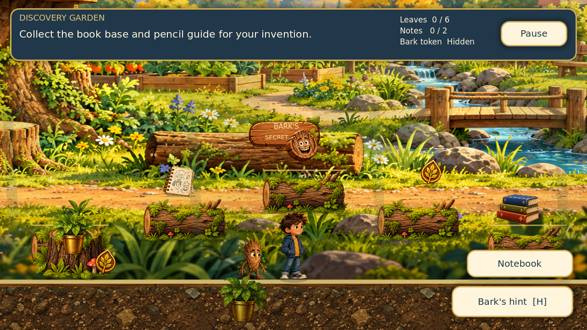
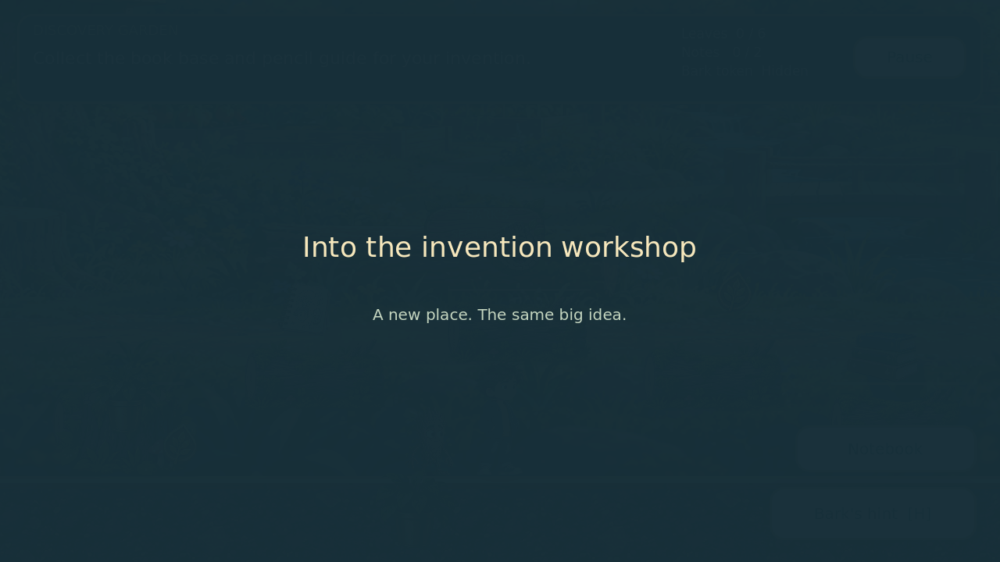

# Room and graphics update

The first chapter retains its tutorial, quest, invention puzzle, discoveries and ending. It now has three distinct room views rather than a seamless panorama. Walk through a signed entrance at the screen edge to leave or re-enter a room. A short transition freezes movement, changes the camera bounds, moves both companions to a safe ground arrival, and saves a checkpoint. Inventory and story flags remain in the existing persistent state. The restored garden shortcut uses the same system.

## Presentation

- Hallway: supplied detailed school painting, warm light, recessed oak entrance sprites, readable noticeboard and reading nook.
- Garden: supplied garden painting, slow parallax, foreground plants, elevated mossy log route, textured secret-nook sign, drifting butterflies and discovery bursts.
- Workshop: a newly generated storybook classroom painting with sunlight, oak materials, science objects, plants and fair bunting. Existing props remain separate interactive sprites.
- Depth: overscanned background parallax, sun shafts, native PointLight2D light pools, prop silhouette contact shadows, player ground shadow and perspective floor accents.
- Animation: distance-driven stride/passing/stride/passing poses for Mark; fuller walk-pose sequences for Bark; tiny idle breathing and lean around original foot anchors. Hint and cheer poses have timed holds.
- Accessibility: reduced motion disables ambient movement, camera smoothing, parallax, breathing and lean. Transitions become shorter. The HUD uses contextual interaction prompts instead of a label hovering over every object.

This is a 2.5D presentation using 2D sprites, layered paintings and lighting. The characters remain the supplied Young Mark and Bark exports, rather than replacement 3D meshes or skeletal rigs. Collision geometry stays independent of the paintings.

## In-game views

## New artwork

Created with the built-in image-generation tool using `assets/school_hub.png` as a style reference. The supplied character identities and artwork were preserved. Generated files are included directly in the project, without an external download dependency:

| Asset | Native canvas | Implementation |
| --- | --- | --- |
| `assets/workshop_hub_v2.png` | 1672 × 941 | Wide warm invention-workshop background; oversized slightly for safe parallax |
| `assets/school_door_v2.png` | 1024 × 1536 RGBA | Transparent oak entrance; foot placement uses a threshold pivot at (512, 1480) |

The exact image-generation prompts used were:

### Workshop

Use case: illustration-story. Generate a production game background for Mark & Bark: The Big Idea. The attached image is STYLE REFERENCE ONLY: keep its detailed painterly children's storybook textures, warm oak, navy, gold, cream, moss palette, softly dimensional hand-painted game art. Create a NEW warm classroom invention workshop, wide 16:9 landscape, approximately orthographic 2D side-view gameplay composition. A welcoming school invention room with tall sunlight-filled windows, oak bookshelves, subtle chalk diagrams with no readable text, science fair paper bunting, pottery plants, wooden beams, paper planes and small science objects on BACKGROUND benches. Strong detailed material texture and depth in window recesses, bevels, sunlight, warm indirect illumination. NO CHARACTERS. NO UI. NO LETTERS or words. Keep foreground empty for separately placed game sprites, especially from x 15% to 85% across the lower quarter: a continuous safe-looking horizontal oak floor line at 84% of image height, with rich floor boards down to bottom. A back-wall display space at right, but no huge foreground desk, no giant central door. Balanced rich detail while readable as background at 1280x720. No modern photorealism, no flat vectors. The output is only this new workshop environment, not a sprite sheet.

### Doorway

Use case: illustration-story. Create a single detailed game sprite on a truly TRANSPARENT background for Mark & Bark, matching the attached warm painterly storybook school reference. Subject: ONE welcoming oak school doorway, front view with a slight readable 3D bevel to the thick wooden frame, softly rounded top, cream plaster/stone arch edging and small trailing moss-green ivy at upper corners. The wooden door stands slightly open inward showing a dark navy shaded passage, with a brass handle. Detailed woodgrain, golden worn edges, soft warm indirect lighting, believable depth and subtle painterly brush textures. A short stone threshold at the base. Entire doorway fully visible with generous transparent padding. No surrounding building, no floor extending outward, no characters, no text, no symbols, no vignette/background, no sprite sheet. Vertical object approximately height 2.4 times width. Suitable as an entrance sprite overlay in a 2D school adventure. Preserve warm oak, cream, navy, gold and moss palette.

## Verification

Run `godot --headless --fixed-fps 60 --path . res://tests/playthrough.tscn` for gameplay checks. On a machine with a graphical display, run `godot --path . res://tests/visual_review.tscn` for deterministic screenshots of the title, tutorial, rooms, transition, workshop controls and touch HUD. Both scenes avoid leaving test state in a player's save file.

Physical phones and tablets, actual speaker playback and child play duration have not been measured. The original key poses are deliberately timed sequences rather than newly authored continuous skeletal animation.
